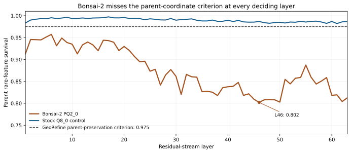

# What GeoRefine’s quality gates test, and how Bonsai-2 scored

The word **quality** can mean fluent output, benchmark accuracy, similarity to a parent model, preservation of internal features, or usable speed. We measure these separately. GeoRefine's thresholds were built for deciding whether **our own compressed artifact** retains its BF16 parent's behavior. Applying them to Bonsai-2 is a declared cross-model diagnostic, not Prism ML's release criterion or an industry definition of intelligence.

## Gate map

| Question | Test and decision rule | Bonsai-2 PQ2_0 result | Verdict for this study |
|---|---|---|---|
| Does the candidate preserve the parent's rare internal features? | SAE readout at every residual layer 1–63; **minimum survival ≥0.975**. Layer 64 is telemetry. | **0.8022** at L46, SE 0.0052; **63/63** deciding layers below 0.975. Same-run Q8_0 control: 0.9820 at its worst layer, 0/63 below. | **Fails GeoRefine's feature criterion.** |
| Does it preserve the parent's assistant-start distribution? | 15 fixed chat probes; each requires KL(parent‖candidate) ≤1.0 nat, L1 probability distance ≤1.0, and parent's top token ranked within candidate top five. | **1/15** probes fails: worst KL **1.1578**, L1 **0.9721**, parent's top token at rank **12**. | **Fails a narrow chat-fidelity probe.** It does not imply ordinary chat is incoherent. |
| Does it reproduce the parent's continuation? | Eight base-LM prompts, greedy parent continuation; weighted score from sequence top-1, KL, diversity and repetition must be **≥0.85**. | **0.7848** vs threshold 0.85; parent self-score **0.9284**. Sequence top-1 0.8048, KL 0.3594. | **Fails parent-continuation fidelity.** This is not a factual-knowledge quiz. |
| Is generated text comprehensible under the small probe? | Eight prompts; mean score **≥0.72** and at most **25%** of probes below the per-probe floor. | Mean **0.8299**; **1/8** probes fails the per-probe floor. | **Passes.** The model can produce fluent, understandable text. |
| Does the composite behavior gate pass? | Logical **AND** of chat, continuation and comprehensibility. It is not a fourth independent experiment. | Chat and continuation fail; comprehensibility passes. | **Fails the composite.** The internal label `INCOHERENT` is too broad for a public capability statement. |
| Does attribution survive? | Separate GeoRefine attribution readout. | **Not run** on Bonsai-2. | **Unmeasured.** No six-component full-stack certificate was issued. |
| Are task losses bounded at the registered margin? | Paired 95% bootstrap **lower bound >−2.0 percentage points** on *both* reasoning-off GSM8K strict and IFEval prompt-strict, plus the other required gates for a full certificate. | GSM8K difference **−2.0 [−3.0, −1.1]** pp; IFEval **−3.3 [−6.7, 0.0]** pp. | **Fails non-inferiority.** GSM8K loss is resolved; IFEval sign is unresolved, but its lower bound is far below the margin. |
| Does the model maintain the tested long-context floor? | Single-fact needle retrieval at approximately 31k and 97k tokens. | **12/12**, matching parent. | **Passes this narrow floor.** Longer and harder long-context tasks remain unmeasured. |

The first six rows describe the `m2_recertify` full-stack components, although Bonsai-2's SAE readout was run in a separately frozen instrument and attribution was not run. **There is no combined six-component certification verdict for Bonsai-2.** The last two rows are additional capability checks, not independent components of that six-part readout. A model may pass fluency and a short benchmark while failing parent fidelity; equally, a low parent-coordinate feature score does not by itself prove lost ability.

## Why the internal feature gate exists

Benchmarks sample a finite set of tasks. They can miss rare or distributed changes in a compressed model. GeoRefine uses sparse autoencoder (SAE) dictionaries fitted to the BF16 parent to ask whether rare parent features still fire in the candidate. The deciding statistic is the *worst* survival over 63 layers, so a single damaged depth cannot be hidden by a high mean. The parent-vs-parent anchor was 1.0; a stock 8-bit Q8_0 candidate was 0.9820 in the same run and passed. Bonsai-2 was 0.8022 at L46, with the [full layer profile](data/sae_layers.csv) below the bar at every deciding depth.

This gate measures **preservation in the parent's feature coordinates**. Bonsai-2 uses trained, rotated low-bit weights, so some function could be re-encoded into a different representation. We have not causally proved that every apparent lost SAE feature is a lost capability. We therefore show the feature result beside output-distribution and task outcomes. The separate descriptive census found 33.9% of rare parent features below its own recall threshold; that statistic is **not numerically interchangeable** with 0.8022 minimum survival.

## What the behavior gates say

The chat result is highly specific. In one structured-text probe, the parent's leading token (“resolve,” probability about 0.266) fell to candidate rank 12 while Bonsai-2 preferred “git.” The other 14 chat probes stayed within the chosen bounds. That is enough to fail a **fail-closed parent-fidelity gate**; it is not a claim that a user will observe broken prose on every conversation.

The continuation test is likewise teacher-relative. It compares the candidate against the parent's own greedy text and combines sequence agreement, distribution shift and repetition/diversity into one score. A score of 0.7848 below 0.85 indicates meaningful deviation by *this metric*. It does not score external facts directly. The independent MMLU result gives a separate capability measurement: Bonsai-2 79.1% versus parent 84.5% on 5,700 questions, a paired difference of −5.33 pp [−6.18, −4.49].

The comprehensibility pass matters. Bonsai-2 remains capable of fluent output, strong benchmark scores, 12/12 tested needles, and very high throughput. Our gate result is **“not parent-preserving by GeoRefine's defined criteria,”** not “not a useful model.” The public report retains those favorable results and the uncertainty around the tasks where differences were not resolved.

## Thinking mode does not erase the gate result

Under the tested thinking-enabled settings, the paired differences on GSM8K, IFEval, HumanEval+ and MBPP+ had intervals containing zero. That shows the benchmark gaps were **not resolved at those sample sizes**. It does not show statistical equivalence, and it does not turn the separate parent-feature or chat/continuation outcomes into passes. The registered primary non-inferiority comparison was the validated reasoning-off head-to-head. Thinking-enabled MMLU and vision were not measured. [Methods](METHODS.md) explains the different settings and validity checks.

## Why these bars should not be mistaken for universal law

The 0.975 SAE survival and −2.0 pp paired margin are GeoRefine's explicit, conservative rules for a particular **parent-preservation** claim. Another deployment might willingly trade a small or even measurable capability loss for Bonsai-2's large size and speed gains. The proper decision is task-specific and should state that trade. Conversely, “no significant gap” on a handful of benchmarks is not enough to claim losslessness. We publish the thresholds, controls, failures and [item-level outcomes](data/paired_outcomes.csv) so readers can apply a different decision rule without changing the measurements.
