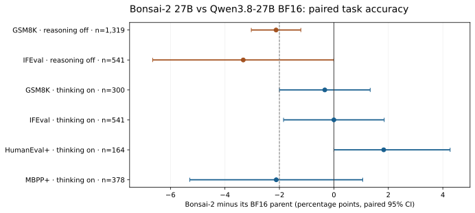

# Bonsai at 27B: an independent fidelity study

**Tsotchke Corporation / GeoRefine · research snapshot: 25 September 2026**

This repository is an independent evaluation of Prism ML's Bonsai models. It is **not** a Prism ML project and does not redistribute Prism's weights. The study identifies the exact model revisions and runtime commits tested; later releases may differ.

The [report](REPORT.md) compares the July 1-bit and ternary models with their Qwen3.6-27B parent, and Bonsai-2 PQ2_0 with its Qwen3.8-27B parent. It presents both efficiency and fidelity results. The [methods supplement](METHODS.md) explains the paired evaluations, internal-feature probe, validity checks, and limitations. [Repair research](REPAIR_RESEARCH.md) records measured progress on a separate 1.7B bed and a testable route toward full-depth low-bit repair. [Results](data/results.json) provides a compact machine-readable ledger; [provenance](PROVENANCE.md) identifies the source receipts and what still needs a public replication bundle.

The [technical supplement](SUPPLEMENT.md) preserves the full set of headline comparison tables and denominator choices for readers who want to audit a number before sharing it.

## Main findings

- **Bonsai-2 is exceptionally small and fast in the tested configuration.** Its 7.21 GB PQ2_0 language GGUF is 7.47× smaller than Prism's matching F16 GGUF. On one RTX PRO 6000 Blackwell with the same Prism llama.cpp build and `llama-bench` configuration, batch-1 128-token decode was 126.54 versus 27.74 tokens/s for BF16 (4.56×). The separate vision projector is excluded from the language GGUF comparison.
- **Benchmark conclusions depend on reasoning mode.** With reasoning disabled and verified, Bonsai-2 was 2.0 percentage points below its parent on GSM8K strict accuracy (95% paired bootstrap interval −3.0 to −1.1; 1,319 items). With thinking enabled under the tested Prism-recommended settings, the flexible-answer difference on a seeded 300-item GSM8K subset was −0.3 points (−2.0 to +1.3). The latter interval does not establish equivalence.
- **The internal-fidelity instrument detects differences.** On a separate parent-coordinate SAE readout, Bonsai-2's worst-layer rare-feature survival was 0.8022, below GeoRefine's stated 0.975 criterion. A stock Q8_0 control reached 0.9820 in the same run. This is a test of preservation in the parent's feature coordinates; it is not a universal measure of model quality.
- **No 27B repair is claimed.** A scale-only distillation run on a separate 1.7B model improved held-out KL and top-1 agreement but did not restore the registered behaviour gates. Full-depth 27B repair remains research.

Read the report before quoting a number: model generation, parent, runtime, reasoning mode, sample count and confidence interval matter. This study does not certify Bonsai, claim that the models are generally incoherent, or establish that an unresolved benchmark difference is zero.

## Data availability

The aggregate figures have been checked against the specified source summaries and receipts. A response-free [paired outcome table](data/paired_outcomes.csv) reproduces the nine main confidence intervals, and [all 63 deciding SAE layers](data/sae_layers.csv) are included. Full prompt and generation traces are not redistributed; [Provenance](PROVENANCE.md) states the remaining independent-rerun requirements.

Copyright © 2026 Tsotchke Corporation. The study, data and analysis scripts are [Apache-2.0 licensed](LICENSE); see [NOTICE](NOTICE). Prism ML and Qwen retain their respective marks, model weights and licenses.
