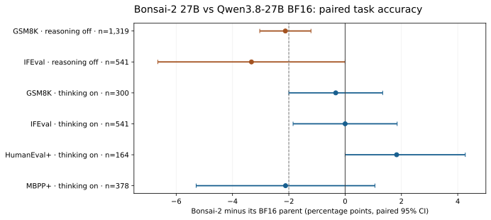

# What ternary keeps, and what it loses

**An independent evaluation of Prism ML's Bonsai 27B models**

Tsotchke Corporation / GeoRefine · measurement window 22–25 September 2026

## Abstract

Prism ML's Bonsai work shows how far trained low-bit models can push inference economics. We compared its July 1-bit and ternary 27B releases with their Qwen3.6-27B parent, and its September Bonsai-2 ternary 27B release with its Qwen3.8-27B parent. Bonsai-2's PQ2_0 language GGUF was 7.21 GB, versus 53.81 GB for Prism's F16 GGUF of the same tensors. On one RTX PRO 6000 Blackwell, controlled batch-1 decode was 126.54 tokens/s for PQ2_0 versus 27.74 tokens/s for a separate 54.66 GB BF16 GGUF of the parent. In a verified reasoning-off, same-runtime evaluation, Bonsai-2 trailed its parent by 2.0 percentage points on GSM8K strict accuracy (95% paired bootstrap interval −3.0 to −1.1). In four tested thinking-enabled tasks, none of the paired differences was statistically resolved; their intervals still admit losses. On our parent-coordinate internal-feature readout, Bonsai-2's worst-layer rare-feature survival was 0.8022 versus a stated 0.975 GeoRefine criterion. These measures answer different questions. The work is an efficiency achievement with remaining parent-relative differences, not a general claim that the model is unusable or that all low-bit training fails.

## 1. Questions and evidence labels

We ask: how much do the shipped artifacts save in storage and measured runtime memory; what happens to task performance under a valid chat/reasoning harness; how much of the parent's next-token and internal-feature behavior remains; and what has actual repair training recovered? **Measured** denotes our pinned run or an artifact check. **Publisher** denotes Prism's reported result. **Interpretation** is an inference from measurements. **Unmeasured** means no result here.

This is an observational comparison of released checkpoints, not a controlled study of Prism's training choices. The two generations have different parents and tokenizers. Their deltas can be compared as context; their absolute scores should not be pooled.

## 2. Models and operating points

| Generation | Candidate | Parent | Packed artifact | Scope |
|---|---|---|---:|---|
| July | Bonsai-27B 1-bit | Qwen3.6-27B | 5.13 GB MLX | Language model in MLX pack |
| July | Ternary-Bonsai-27B | Qwen3.6-27B | 8.49 GB MLX | Language model in MLX pack |
| September | Bonsai-2 PQ2_0 | Qwen3.8-27B | 7,206,168,928 bytes | Language GGUF, 851 tensors; separate vision projector |
| September | Bonsai-2 PTQ1_0 | Qwen3.8-27B | 5,946,648,928 bytes | Language GGUF, same tensor inventory |

The September PQ2_0 file is 7.47× smaller than Prism's 53,808,408,928-byte F16 GGUF of the **same 851 tensors**. PTQ1_0 is 9.05× smaller. Those are whole-file ratios, not bits per every parameter. The 931,145,856-byte BF16 vision projector is separate from the GGUF. The MLX pack includes vision and has a different size denominator. See [Methods §1](METHODS.md#1-artifacts-and-runtime) and [Provenance](PROVENANCE.md).

Prism describes Bonsai-2 as a trained, rotated ternary model. We verified its model files and used Prism's `llama.cpp` fork at `0324c66521960d67aa7da8687fb1453a79a6565c` for the controlled comparisons. The developer Q2_0 file can load in stock llama.cpp while missing Prism's activation transform; it is not a valid substitute for these measurements. [Prism's developer card](https://huggingface.co/prism-ml/Ternary-Bonsai-2-27B-gguf-dev) documents that risk.

## 3. Efficiency: unusually strong, with a narrow benchmark scope

| Same-card `llama-bench`, batch 1 | Parent F16 | Bonsai-2 PQ2_0 | Ratio |
|---|---:|---:|---:|
| Decode, 128 generated tokens | 27.74 tok/s | 126.54 tok/s | 4.56× |
| Prefill, 512 tokens | 3,854 tok/s | 4,014 tok/s | 1.04× |
| VRAM at 32k context | 50.7 GiB | 9.4 GiB | 5.4× less resident memory |

The measured decode speed is a **single-card, single-build, single-configuration** result; it is not an end-to-end server throughput guarantee. The report source also records a separate 118.81 tok/s server observation for Bonsai-2. We do not combine that observation with the parent's `llama-bench` rate to claim a speedup. PTQ1_0's controlled rate was 121.8 tok/s; smaller file size did not make it faster here.

## 4. Capability: distinguish reasoning-off and thinking-enabled evidence

For the reasoning-off comparison, we ran parent and Bonsai-2 through the same pinned Prism runtime and chat-completion harness. A probe confirmed thinking was disabled for **each** arm; all 1,319 GSM8K and 541 IFEval responses were nonempty. Per-item results were paired, with 10,000 bootstrap resamples. Percentage-point differences below are candidate minus parent.

| Reasoning off | Parent | Bonsai-2 PQ2_0 | Paired difference, 95% CI |
|---|---:|---:|---:|
| GSM8K strict, 1,319 | 97.3% | 95.3% | −2.0 [−3.0, −1.1] |
| GSM8K flexible extraction, 1,319 | 97.3% | 95.2% | −2.1 [−3.0, −1.2] |
| IFEval prompt-strict, 541 | 82.3% | 78.9% | −3.3 [−6.7, 0.0] |

The GSM8K gap is resolved at this sample size. The IFEval interval reaches zero. The registered −2-point non-inferiority criterion requires the *lower* CI bound to be greater than −2 on both tasks; Bonsai-2 does not meet it. In this IFEval run, even higher-bit controls lacked enough precision to pass that rule, so its failure does not uniquely separate Bonsai-2 from them.

In the thinking-enabled run we used Prism's recommended `xhigh` chat settings, sampling, a 32,768-token generation budget, separate final-answer scoring, and a pre-registered validity check for empty or truncated responses. Every arm/task stayed below the 2% invalidity ceiling. The paired results were:

| Thinking enabled | Items | Candidate minus parent, pp [95% CI] |
|---|---:|---:|
| GSM8K flexible extraction | 300 | −0.3 [−2.0, +1.3] |
| IFEval prompt-strict | 541 | 0.0 [−1.8, +1.8] |
| HumanEval+ | 164 | +1.8 [0.0, +4.3] |
| MBPP+ | 378 | −2.1 [−5.3, +1.1] |

No difference is statistically resolved on these four tasks. This **does not demonstrate equivalence**: the intervals permit, for example, a 5.3-point MBPP+ loss. The same registered −2-point rule is not met on GSM8K (its lower bound equals the boundary) or MBPP+. Prism's published difference for each of these four tasks lies within our measured interval; we did not reproduce the remaining ten tasks in its 14-task headline. Thinking-enabled MMLU and vision were not run.

The two modes used different sampling and answer budgets; the off-mode coding parent also used a different llama.cpp build. Their change in score is therefore a comparison of tested configurations, **not** an isolated causal effect of turning thinking on. The parent and Bonsai-2 spent 6–20% different mean reasoning tokens across the four tasks; cost should be measured with those tokens included.

## 5. Additional capability and fidelity measurements

| Measurement | Bonsai-2 result | Interpretation and limit |
|---|---:|---|
| MMLU, reasoning off, 5,700 questions | 79.1% vs parent 84.5%; −5.33 pp [−6.18, −4.49] | Paired item result; no thinking-enabled MMLU |
| MBPP+, reasoning off, 378 problems | 74.1% vs parent 77.0%; −2.9 pp [−5.6, −0.3] | Parent/reference coding runs used stock llama.cpp; runtime is a confound |
| HumanEval+, reasoning off, 164 problems | 86.0% vs parent 90.2%; −4.3 pp [−9.2, +0.6] | Interval crosses zero; same runtime caveat |
| MMMU validation pilot, first 128 | 46.9% vs parent 55.5%; −8.6 pp [−17.2, 0.0] | Pilot only; interval reaches zero |
| Needle retrieval | 12/12 at approximately 31k and 97k | Narrow single-fact retrieval, not general long-context reasoning |

For internal probes, we materialized a BF16 proxy from Prism's MLX pack. On 25,550 held-out positions, its next-token distribution closely matched the shipped PQ2_0 file running under Prism's fork (mean KL 0.000351; top-1 98.87%). This validates it **for the tested comparison**, not bitwise identity of all intermediate activations. The proxy's parent-relative held-out next-token KL was 0.354 nats and top-1 agreement 74.5%. Its residual-stream similarity declined with depth.

Our SAE readout tests survival of the **parent's** rare features in the **parent's feature coordinates**. Bonsai-2's minimum over layers 1–63 was 0.8022; the GeoRefine criterion was 0.975. A Q8_0 control in the same run scored 0.9820. A separate descriptive census found 33.9% of rare parent feature firings lost under its own threshold. These are different statistics and should not be interchanged. Rotation, scaling, or re-encoding could lower parent-coordinate readouts even when some behavior is preserved. We therefore report these probes alongside outputs and task scores, not as a universal definition of intelligence.

Our three small teacher-relative behavior probes yielded: one of 15 chat probes outside the stated budget, knowledge-continuation fidelity 0.785 versus a 0.85 threshold, and comprehensibility 0.830 (passing). The internal **coherence gate** is a logical conjunction of those three tests. Its failing result does **not** mean the model is generally incoherent or unable to chat. The “knowledge” probe compares continuations with the parent; it is not a factual-knowledge exam.

## 6. July generation and repair context

The July 1-bit and ternary models were compared with **Qwen3.6-27B**, not Bonsai-2's Qwen3.8 parent. Their reasoning-off MMLU scores were 68.1% and 77.7%, against 85.2% for their parent. On the same parent-relative held-out corpus, next-token KL was 0.735 and 0.480 nats. These are meaningful historical reference points, but generation-to-generation improvement is not isolated from the changed parent, tokenizer, format and evaluation implementation.

On a **separate 1.7B** Bonsai repair bed, end-to-end scale training with 32× more unique data reduced held-out KL from 0.608 to 0.465 and raised top-1 agreement from 71.4% to 75.3%. No registered behavior gate flipped; one chat measure worsened, and a sign-training export crashed. This is local repair progress, **not a repaired 27B model**. See [Repair research](REPAIR_RESEARCH.md).

## 7. What invalid runs taught us

Three Bonsai-2 comparisons looked plausible and were rejected before the valid run. Raw completions yielded empty GSM8K answers from a chat-template-dependent model. Thinking enabled under a 4,096-token budget produced empty final answers on 18–29% of cases and falsely suggested a 7.5-point GSM8K advantage. A server flag intended to disable reasoning did not actually disable it. The valid run used the chat template, checked the `reasoning_content` channel per arm, increased the thinking budget, and rejected high empty/truncated rates. Thinking-on GSM8K *strict* scoring still suggested a +7.3-point Bonsai-2 gain, but this was answer-format adherence (`#### N`); flexible numerical extraction showed −0.3 [−2.0, +1.3]. [Methods](METHODS.md) gives the exact validity rule and amendments.

## 8. Conclusion

Bonsai-2 achieves an unusually strong size and decode-efficiency point. Under our reasoning-off head-to-head, several parent-relative losses are resolved; under the tested thinking-enabled configuration, the four measured task differences are not resolved, but equivalence is not established. Its next-token and parent-coordinate feature probes show substantial differences from its parent. A useful deployment decision depends on the intended task, acceptable errors, reasoning-token budget, hardware, and whether preserving parent behavior matters. The work motivates more targeted low-bit repair; it does not show a completed 27B repair.

This analysis is independent of Prism ML. We invite corrections to measurements or interpretation through a documented issue or reproducible receipt. [Methods](METHODS.md) and [Provenance](PROVENANCE.md) state exactly what another team would need to replicate it.

## References

- [Prism ML, Bonsai-2 model card](https://huggingface.co/prism-ml/Ternary-Bonsai-2-27B-gguf), pinned artifact revision `6ed5e12b` for this study.
- [Prism ML, developer Q2_0 runtime warning](https://huggingface.co/prism-ml/Ternary-Bonsai-2-27B-gguf-dev).
- [Qwen3.8-27B parent](https://huggingface.co/Qwen/Qwen3.8-27B), revision `1d4bf0f2ff6012fd82039f2fa52739d0dd7c60c0`.
- [Prism ML, July ternary model](https://huggingface.co/prism-ml/Ternary-Bonsai-27B-mlx-2bit), revision `70f75f3ad081`.
- [Prism ML, July 1-bit model](https://huggingface.co/prism-ml/Bonsai-27B-mlx-1bit), revision `ef22f239c670`.
